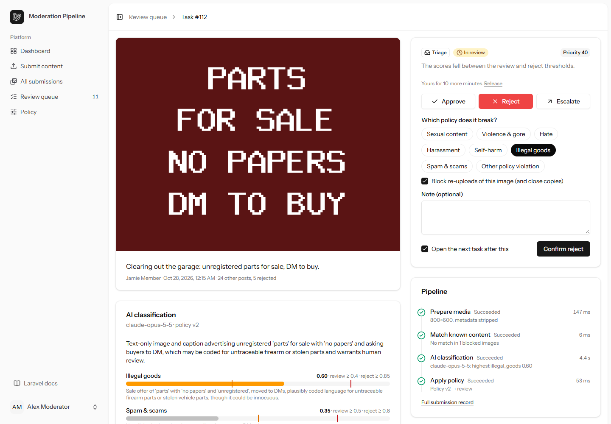
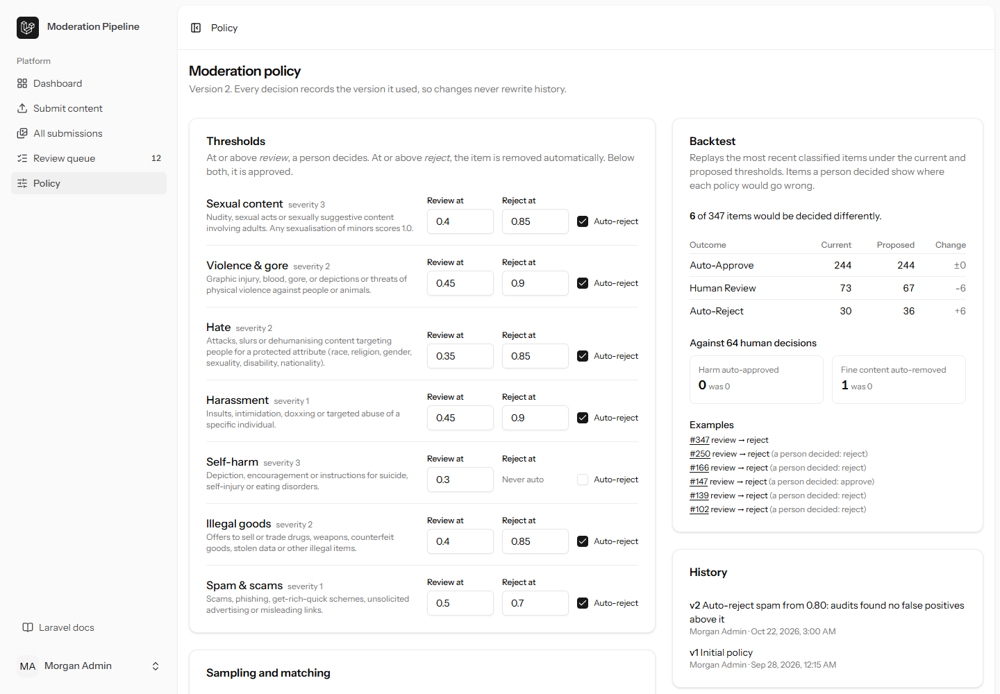
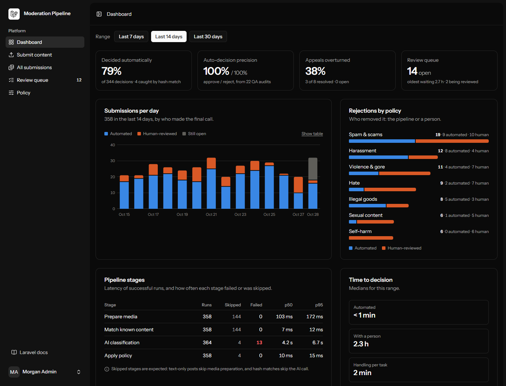

# Moderation Pipeline

An AI content-moderation pipeline built with Laravel 13 and Vue 3. Uploaded images and captions go through four
queued stages. Confident results are decided automatically. Anything uncertain lands in a human review queue with
claim locks, escalation, appeals and QA audits.

It is meant to show **queues, jobs and AI in a background-processing context**: no request ever waits on the model.
It also shows the operational side of moderation that demos usually skip:

- policy thresholds you can version and backtest;
- re-uploads of known-bad images caught without an AI call;
- measured precision of the automated decisions.



## How it works

```
Upload ─► PrepareMedia ─► MatchKnownContent ─► ClassifyContent ─► ApplyPolicy
          re-encode,       SHA-256 + dHash      Claude vision,      thresholds from the
          strip EXIF/GPS,  vs. blocklist        structured output   current policy version
          thumbnail,       (no AI call on       (own queue, rate    │
          fingerprint      a match)             limited)            ├─ approve  ─┐
                                                                    ├─ reject   ─┼─► random QA audit sample
                                                                    └─ review ──► human review queue
```

- **Queues:** `moderation` (cheap stages) and `moderation-ai` (the model call, rate limited across workers). With a
  worker on each, as `composer run dev` runs them, a slow or throttled model never holds up media processing.
- **Fail safe:** if classification fails, the model refuses, or any stage runs out of retries, the item goes to a
  person. It is never approved.
- **Review tasks:**

    | Task       | When it is created                                                     |
    | ---------- | ---------------------------------------------------------------------- |
    | Triage     | The scores fell between the review and reject thresholds.              |
    | Escalation | A moderator handed the item up; only admins can take it.               |
    | Appeal     | The uploader disputed a rejection. The original decider can't take it. |
    | QA audit   | A random sample of automated decisions. Disagreeing overturns them.    |

    Claims are atomic, 10-minute leases.

- **Policy versions:** thresholds are append-only. Every decision records the version it used. The Policy page
  backtests proposed thresholds against recent items and against human decisions before you save.
- **Model evaluation:** before switching models or effort levels, an admin re-scores recent human-decided items
  with the candidate through the Message Batches API (half price, usually done in a minute or two). The report
  judges the recorded scores and the candidate's under the same thresholds against what people decided: automated
  decisions people agreed with, harm approved automatically, fine content removed, cost per item and score drift
  per category. Batch requests are built by the same code as live ones, prompt caching included.

## Stack

Laravel 13 · PHP 8.4 · Inertia v3 · Vue 3 + TypeScript · Tailwind 4 · shadcn-vue · Pest · GD · Claude
(`claude-opus-5-5`) via the official Anthropic PHP SDK.

## Quick start

```bash
composer install && npm install
cp .env.example .env && php artisan key:generate
# Without an API key, use the offline classifier:
#   MODERATION_CLASSIFIER=fake   (in .env)
php artisan migrate --seed       # two weeks of demo history + sample images
composer run dev                 # web server + one worker per pipeline queue + Vite
```

Demo accounts (password `password`):

| Email                 | Role                                              |
| --------------------- | ------------------------------------------------- |
| admin@example.com     | Admin: can edit the policy and decide escalations |
| moderator@example.com | Moderator (also priya@, tomas@)                   |
| member@example.com    | Uploader                                          |

Open **Submit content** and use the sample buttons. Each one follows a different path through the pipeline:
auto-approve, auto-reject, human review, an exact and a near-duplicate blocklist match, a text-only insult that needs a
judgement call, and a self-harm post that always reaches a person.

### Configuration

```dotenv
MODERATION_CLASSIFIER=claude          # or "fake" (keyword rules, no network)
ANTHROPIC_API_KEY=sk-ant-...
ANTHROPIC_MODEL=claude-opus-5-5
MODERATION_AI_CALLS_PER_MINUTE=30
MODERATION_AUDIT_SAMPLE_RATE=0.05     # default for the first policy version
```

The fake classifier reads the caption and filename only. It also accepts pinned scores such as `[violence:0.6]`,
and `[refuse]` simulates a model refusal, which is handy for demos and tests.

Measured against the live API (`claude-opus-5-5`, effort `low`), one classification takes 3 to 5 seconds and uses
200 to 300 output tokens. Its input is a fixed 2,093-token prefix (the instructions and the output schema), about
50 tokens of caption and about 640 more for an image. The prefix is marked for prompt caching, so after the first
call it is read from the cache at a twentieth of the input price:

| Per item      | Before caching | With a warm cache |
| ------------- | -------------- | ----------------- |
| Text only     | about $0.014   | about $0.006      |
| With an image | about $0.016   | about $0.007      |

Every classification records its token counts, and the dashboard shows the estimated spend, the share of input
served from the cache and what caching saved.

## Screenshots

| Policy backtest                                                                                         | Staff dashboard                                                      |
| ------------------------------------------------------------------------------------------------------- | -------------------------------------------------------------------- |
|  |  |

## Tests

```bash
php artisan test        # 108 tests: pipeline, review workflow, policy, access, SDK request shape
npm run types:check
npm run check
```

`tests/e2e/smoke.mjs` drives the real app in an installed Edge or Chrome. It runs every sample through the queued
pipeline, appeals, reviews and escalates, backtests the policy, and checks the staff pages in light, dark and phone
widths. Run it against a freshly seeded app with workers running (`composer run dev`):

```bash
E2E_URL=http://127.0.0.1:8000 npm run test:e2e   # screenshots go to storage/e2e
```

## Project layout

| Path                  | What's there                                                                                                   |
| --------------------- | -------------------------------------------------------------------------------------------------------------- |
| `app/Jobs/`           | The four pipeline stages and the step recorder                                                                 |
| `app/Moderation/`     | `PolicyEngine` (pure), `ModerationService` (decisions, claims, appeals), `PolicyBacktest`, `ModerationMetrics` |
| `app/Ai/`             | `ContentClassifier` contract, Claude and fake implementations, structured-output schema                        |
| `app/Support/`        | `MediaSanitizer` (re-encode, EXIF/GPS strip, thumbnails), `PerceptualHash` (dHash)                             |
| `resources/js/pages/` | Submissions, review queue and workspace, policy editor, staff dashboard                                        |
